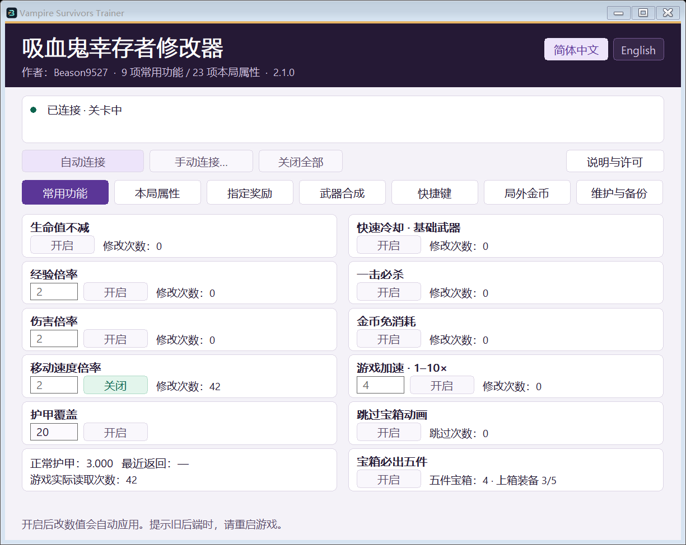
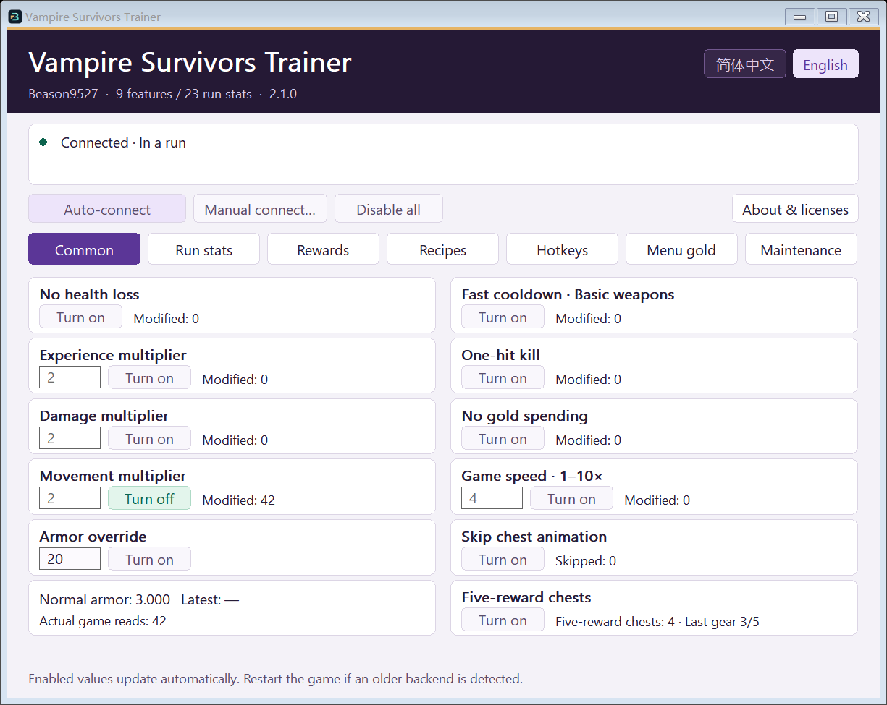

<h1 align="center">Vampire Survivors Trainer</h1>

  <strong>吸血鬼幸存者修改器作弊器</strong> 
  Windows x64 · Single EXE · 简体中文 / English

  <a href="https://github.com/beason409/VampireSurvivorsTrainer-Native/releases/latest"><strong>下载正式版 / Download</strong></a>
  &nbsp;·&nbsp; <a href="docs/SECURITY.md">下载核验 / Verify</a>
  &nbsp;·&nbsp; <a href="#english">English guide</a>

游戏 / Game <strong>1.16.111</strong> · Steam Build <strong>25984009</strong> · 单人模式 / Single-player

<table align="center">
  <tr>
    <th>简体中文</th>
    <th>English</th>
  </tr>
  <tr>
    <td></td>
    <td></td>
  </tr>
</table>

2.1.0 界面预览，使用示例连接状态。点击查看原图。 2.1.0 UI previews with a sample connection state. Click to view full size.

## 简体中文

### 快速开始

1. 从发布页下载 `VampireSurvivorsTrainer.Native.exe`，双击运行。从 Steam 启动游戏，两个程序的启动顺序不限。
2. 等待自动连接。需要指定安装位置时，点击「手动连接…」，选择包含 `VampireSurvivors.exe` 的文件夹。
3. 进入单人关卡后，使用「常用功能」或「本局属性」。需要切换语言时，点击右上角的语言按钮。

### 功能

| 页面 | 功能 |
| --- | --- |
| 常用功能 | 生命保护、倍率、快速冷却、一击必杀、1～10 倍游戏加速、跳过宝箱动画和普通宝箱五件奖励 |
| 本局属性 | 编辑护甲等 23 项属性，开启后可直接改值 |
| 指定奖励 | 按名称搜索物品，为普通宝箱或升级指定目标 |
| 武器合成 | 查看当前游戏与已加载 DLC 的配方、素材图标和等级条件 |
| 快捷键 | 为开关型功能设置游戏内快捷键 |
| 局外金币 | 设置普通模式或当前冒险的独立钱包，保存前核对模式和余额 |
| 维护与备份 | 在本机创建、查看和恢复备份 |

武器合成和指定奖励在连接后自动加载一次，之后可手动刷新。金币设值需要本次游戏启动前创建的有效备份。

从 **1.0.0** 升级时，先退出游戏，用旧修改器的「维护与备份 → 卸载插件」卸载旧插件，并保留备份。之后重新启动游戏和新版修改器。

## English

Download `VampireSurvivorsTrainer.Native.exe` from the [latest release](https://github.com/beason409/VampireSurvivorsTrainer-Native/releases/latest). Start the trainer and Steam game in either order. The trainer connects automatically. To select the game folder yourself, choose **Manual connect…** and select the folder containing `VampireSurvivors.exe`.

- Adjust 23 run stats, use health protection and multipliers, or speed up the game to 10×. Bind hotkeys to toggled effects.
- Skip ordinary chest animations or enable five-reward chests. Target a chest or level-up reward, and browse weapon recipes for the loaded game and DLC. Both lists load once per connection and can be refreshed manually.
- Set the base game or active adventure’s menu gold using a valid backup created before starting the game. Create and restore backups from **Maintenance**.

If you are upgrading from **1.0.0**, close the game and uninstall its companion plugin through the old trainer’s **Maintenance & Backup** page. Keep your backups before starting the game and the new trainer.

## 文档 / Documentation

[原生功能说明](native/README.md) · [验证记录](VALIDATION.md) · [数据与权限](docs/PRIVACY.md) · [构建 / Build](docs/BUILDING.md) · [许可 / License](LICENSE) · [第三方组件](THIRD-PARTY-NOTICES.md)

由 **Beason9527** 独立开发。Independent project by **Beason9527**, unaffiliated with the game developer or Steam.
